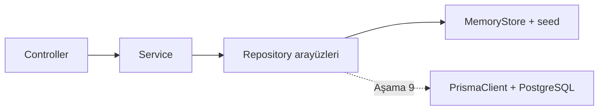
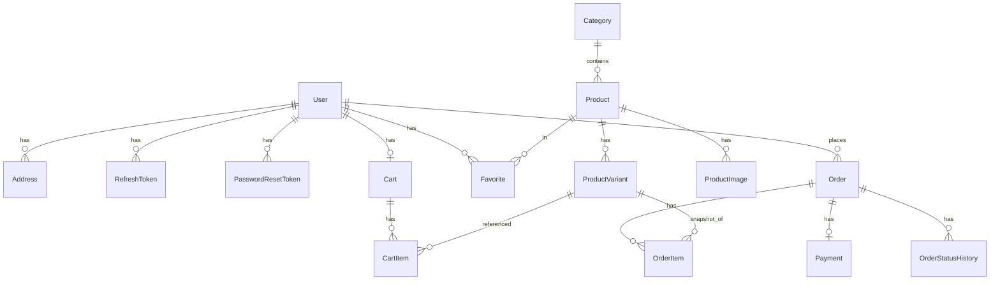

# Sistem Tasarımı — Giyim E-Ticaret Uygulaması

## 1. Mevcut Durum Analizi

- Çalışma alanı (`kı/`) proje başlangıcında tamamen boştu; korunması gereken kod veya bağımlılık yoktur.
- Ortam: Node.js 24.x, npm 11.x, git 2.47, Docker 29.x mevcut. `psql` ve çalışan bir PostgreSQL sunucusu yok.
- Karar: Veritabanı bağlantısı **en son aşamada** (Aşama 9) kurulacak. Bu aşamaya kadar backend gerçek bir REST API olarak çalışır ancak verileri bellek içi (in-memory) bir repository katmanında tutar. Servis ve controller katmanları yalnızca repository arayüzlerini gördüğü için Prisma/PostgreSQL geçişi iş kurallarını değiştirmez.

## 2. Teknoloji Yığını

| Katman | Teknoloji |
| --- | --- |
| Frontend | React 18, TypeScript, Vite, React Router v6, Tailwind CSS, TanStack Query, Zustand, React Hook Form + Zod, lucide-react |
| Backend | Node.js, TypeScript, Express 4, Zod, jsonwebtoken, bcryptjs, helmet, cors, cookie-parser, express-rate-limit, pino |
| Paylaşılan | `packages/shared`: Zod şemaları + DTO tipleri (her iki uygulama da buradan import eder) |
| Veri | Aşama 2–8: in-memory repository (seed verili, isteğe bağlı JSON dosyasına kalıcılık). Aşama 9: Prisma ORM + PostgreSQL |
| Test | Vitest, React Testing Library, Supertest, Playwright |
| Araçlar | ESLint, Prettier, npm workspaces |

## 3. Monorepo Yapısı

```text
kı/
├── apps/
│   ├── web/                    # React + Vite istemci
│   │   └── src/
│   │       ├── app/            # router, providers, layouts
│   │       ├── components/     # ui, common, product, cart, checkout, admin
│   │       ├── features/       # auth, catalog, cart, checkout, orders, account, admin (sayfalar + hook'lar)
│   │       ├── lib/            # api-client, query-client, utils
│   │       ├── services/       # endpoint sarmalayıcıları (auth.service.ts, product.service.ts ...)
│   │       ├── store/          # Zustand store'ları (auth, guest cart, ui)
│   │       └── styles/         # tokens.css, globals.css
│   └── api/                    # Express API
│       └── src/
│           ├── config/         # env doğrulama, sabitler
│           ├── middleware/     # auth, role, validate, error-handler, rate-limit
│           ├── modules/        # auth, users, products, categories, cart, favorites, addresses, orders, payments, admin
│           ├── shared/
│           │   ├── db/
│           │   │   ├── repositories/   # arayüzler
│           │   │   ├── memory/         # in-memory implementasyon + seed
│           │   │   └── prisma/         # Aşama 9
│           │   ├── errors/
│           │   └── utils/
│           ├── app.ts
│           └── server.ts
├── packages/shared/            # Zod şemaları ve tipler
├── prisma/                     # schema.prisma (Aşama 2'de sözleşme, Aşama 9'da migration + seed)
├── docs/
├── .env.example
├── package.json                # npm workspaces
└── README.md
```

Her modül `routes.ts → controller.ts → service.ts → repository` sırasıyla katmanlanır. İş kuralları yalnızca `service` katmanında yaşar.

## 4. Veri Erişim Katmanı



- `DATA_SOURCE=memory|prisma` env değişkeni hangi implementasyonun kullanılacağını belirler.
- `MemoryStore`, `DATA_PERSIST_FILE` tanımlıysa her yazma işleminden sonra JSON dosyasına yazar (geliştirme kolaylığı; dosya `.gitignore` içindedir). Bu, LocalStorage'da sipariş tutmak değildir; veri sunucu tarafındadır ve API üzerinden erişilir.
- Stok ve sipariş işlemleri `UnitOfWork.runExclusive()` içinde çalışır: memory implementasyonu bir mutex ile serileştirir, Prisma implementasyonu `$transaction` kullanır. Böylece eşzamanlı satın alma stoğu negatife düşüremez.

## 5. Para Birimi

Tüm tutarlar **kuruş cinsinden tam sayı** olarak tutulur (`priceCents`, `totalCents`). Hiçbir yerde float kullanılmaz. Frontend'de `Price` componenti `Intl.NumberFormat('tr-TR', { style: 'currency', currency: 'TRY' })` ile biçimlendirir.

## 6. Veri Modeli



### Alanlar (özet)

- **User**: id, email (unique), passwordHash, firstName, lastName, phone?, role (`CUSTOMER|ADMIN`), isActive, createdAt, updatedAt
- **RefreshToken**: id, userId, tokenHash (unique), expiresAt, revokedAt?, createdAt
- **PasswordResetToken**: id, userId, tokenHash, expiresAt, usedAt?
- **Address**: id, userId, title, firstName, lastName, phone, city, district, postalCode?, line, isDefault
- **Category**: id, name, slug (unique), description?, imageUrl?, isActive, sortOrder
- **Product**: id, name, slug (unique), description, priceCents, compareAtPriceCents?, categoryId, status (`ACTIVE|DRAFT|ARCHIVED`), isFeatured, isNew, deletedAt?, createdAt, updatedAt
- **ProductImage**: id, productId, imageUrl, altText, sortOrder
- **ProductVariant**: id, productId, sku (unique), size (`S|M|L|XL|XXL`), color, colorHex?, stockQuantity (>=0), priceOverrideCents?, isActive
- **Cart**: id, userId (unique), updatedAt
- **CartItem**: id, cartId, productId, variantId, quantity (>0); `(cartId, variantId)` unique
- **Favorite**: userId + productId (composite unique)
- **Order**: id, orderNumber (unique), userId?, guestEmail?, status, paymentStatus, paymentMethod, subtotalCents, discountCents, shippingCents, totalCents, shippingAddress (JSON snapshot), note?, idempotencyKey?, createdAt, updatedAt
- **OrderItem**: id, orderId, productId, variantId, productName, variantSku, size, color, imageUrl, unitPriceCents, quantity, lineTotalCents
- **Payment**: id, orderId, provider (`mock|iyzico|cod|bank_transfer`), providerPaymentId?, status, amountCents, reference, lastWebhookEventId?, rawResultSummary (hassas veri yok), createdAt
- **OrderStatusHistory**: id, orderId, fromStatus, toStatus, note?, trackingNumber?, changedByUserId?, createdAt
- **AuditLog**: id, actorUserId, action, entityType, entityId, metadata, createdAt

### Silme davranışları

- Ürün: `DELETE /admin/products/:id` soft delete yapar (`deletedAt`, status=ARCHIVED). Sipariş kalemleri tarihsel kopya taşıdığından geçmiş bozulmaz.
- Kategori: pasife alınabilir; ürünü olan kategori silinemez.
- Kullanıcı: pasife alma (`isActive=false`); siparişler korunur.

## 7. Kimlik Doğrulama ve Oturum

- **Access token**: JWT (HS256), 15 dk ömür, yalnızca bellekte (Zustand) tutulur. Sayfa yenilemede `POST /auth/refresh` ile yeniden alınır.
- **Refresh token**: 7 gün, rastgele 48 byte, sunucuda SHA-256 hash'i saklanır, `HttpOnly; SameSite=Lax; Secure (prod); Path=/api/v1/auth` cookie olarak gönderilir. Her kullanımda rotate edilir, eski token iptal edilir. Logout tüm cihazlar için değil, ilgili token için iptal yapar.
- **Parola**: bcrypt (cost 12). Kurallar: en az 8 karakter, bir harf ve bir rakam.
- **Roller**: `CUSTOMER`, `ADMIN`. `requireAuth` → `requireRole('ADMIN')` middleware zinciri; `/api/v1/admin/*` tamamı bu zincirden geçer. Admin kayıt formundan seçilemez; seed ile oluşturulur (`ADMIN_EMAIL`, `ADMIN_PASSWORD` env).
- **Kaynak sahipliği**: adres, sepet, sipariş, favori servisleri her zaman `userId` ile filtreler; başkasına ait kaynak 404 döner (bilgi sızdırmamak için).
- **Frontend**: tek `api-client.ts`; 401'de tek bir refresh isteği kuyruklanır (yarış koşulu yok), başarısız olursa oturum kapatılır. Her istekte 15 sn timeout ve `AbortController`.
- **Rate limit**: `/auth/login`, `/auth/register`, `/auth/forgot-password` için IP başına 10 istek/15 dk; genel API 300 istek/15 dk.

## 8. Sepet Akışı

```mermaid
sequenceDiagram
  participant U as Kullanıcı
  participant W as Web (Zustand)
  participant A as API
  U->>W: Beden + adet seç, Sepete ekle
  alt Misafir
    W->>W: localStorage'a {variantId, quantity} yaz
    W->>A: POST /cart/validate (satırlar)
    A-->>W: fiyat, stok, uyarılar, özet
  else Giriş yapmış
    W->>A: POST /cart/items
    A-->>W: sunucu sepeti + özet
  end
  U->>W: Giriş yap
  W->>A: POST /cart/merge (misafir satırları)
  A-->>W: birleştirilmiş sepet; localStorage temizlenir
```

- Misafir sepetinde fiyat tutulmaz; her görüntülemede `POST /cart/validate` ile sunucu hesaplar.
- Birleştirme politikası: aynı `variantId` → adetler toplanır ve stokla sınırlanır; farklı varyantlar ayrı satır kalır; stokta olmayan satırlar düşürülür ve kullanıcıya bildirilir.
- Kargo kuralı `config/commerce.ts` içinde: 1.500 TL üzeri ücretsiz, altı 79,90 TL. İndirim kuralı yok (0 gösterilir, "kupon" özelliği kapsam dışı).

## 9. Sipariş Oluşturma Akışı

1. `POST /orders` (`Idempotency-Key` header'ı zorunlu). Misafir ise `guestEmail` + sepet satırları body'de, giriş yapmış ise sunucu sepeti kullanılır.
2. Teslimat adresi Zod ile doğrulanır (kayıtlı adres id'si veya inline form).
3. `runExclusive` içinde: her varyant aktif mi, ürün ACTIVE mi, stok yeterli mi kontrol edilir; birim fiyat = `variant.priceOverrideCents ?? product.priceCents`.
4. Toplamlar sunucuda hesaplanır; frontend'den gelen tutar kullanılmaz.
5. Sipariş + kalemler + ödeme kaydı + ilk durum geçmişi oluşturulur; stok düşülür.
6. Ödeme yöntemine göre: `COD` → sipariş `PENDING`/ödeme `PENDING`; `BANK_TRANSFER` → aynı + havale talimatı + referans; `CREDIT_CARD` → `PaymentProvider.initializePayment()` çağrılır, sonuç `verifyPayment()` ile doğrulanır; başarısızsa ödeme `FAILED`, sipariş `CANCELLED`, stok iade.
7. Giriş yapmış kullanıcının sunucu sepeti temizlenir.

### Durum makinesi

| Mevcut | İzin verilen |
| --- | --- |
| PENDING | CONFIRMED, CANCELLED |
| CONFIRMED | PREPARING, CANCELLED |
| PREPARING | SHIPPED, CANCELLED |
| SHIPPED | DELIVERED |
| DELIVERED | RETURNED |
| CANCELLED / RETURNED | — |

- `CANCELLED` ve `RETURNED` geçişlerinde stok iade edilir; ödeme `PAID` ise `REFUNDED` olarak işaretlenir (mock sağlayıcıda `refundPayment`).
- `SHIPPED` geçişinde kargo takip numarası zorunludur.
- Müşteri yalnızca `PENDING` veya `CONFIRMED` siparişini iptal edebilir.

## 10. Ödeme Mimarisi

```text
PaymentProvider
  initializePayment(input): Promise<{ providerPaymentId, status, redirectUrl?, reference }>
  verifyPayment(providerPaymentId): Promise<{ status: 'PAID'|'FAILED'|'PENDING' }>
  handleWebhook(rawBody, headers): Promise<{ eventId, providerPaymentId, status }>
  refundPayment(providerPaymentId, amountCents): Promise<{ status }>
```

- `MockPaymentProvider`: kart numarası `4111 1111 1111 1111` → başarılı, `4000 0000 0000 0002` → reddedildi. Kart verisi yalnızca istek gövdesinde Zod ile doğrulanır, loglanmaz ve saklanmaz; yanıtta yalnızca son 4 hane döner.
- Webhook idempotency: `Payment.lastWebhookEventId` ve işlenmiş event listesi; aynı `eventId` tekrar gelirse 200 döner, hiçbir şey değişmez.
- `IyzicoPaymentProvider` Aşama 9'da aynı arayüze eklenir; anahtarlar yalnızca backend env'de.

## 11. Güvenlik Riskleri ve Önlemler

| Risk | Önlem |
| --- | --- |
| XSS ile token çalınması | Access token bellekte, refresh HttpOnly cookie; React varsayılan escape; helmet CSP başlıkları |
| CSRF | Refresh cookie `SameSite=Lax` + özel `X-Requested-With` kontrolü; access token header ile gönderilir |
| Brute force | express-rate-limit, genel ve şifre hatası mesajları ("E-posta veya şifre hatalı") |
| IDOR | Tüm kullanıcı kaynaklarında `userId` filtresi; admin dışı rol için 404 |
| Fiyat manipülasyonu | Sepet ve sipariş tutarları yalnızca sunucuda hesaplanır |
| Stok yarışı | Sipariş oluşturma mutex/transaction içinde; stok `>= quantity` koşuluyla düşülür |
| Mükerrer sipariş | `Idempotency-Key` + kullanıcı başına saklanan yanıt |
| Mükerrer webhook | `eventId` kaydı |
| Hassas veri sızıntısı | DTO mapper'lar `passwordHash`, token hash'leri ve kart verisini asla döndürmez; pino redaksiyonu |
| Yetki atlatma | `/admin` router seviyesinde `requireAuth + requireRole('ADMIN')`; frontend guard yalnızca UX |
| Gizli bilgiler | `.env` git dışında, `.env.example` sağlanır, env Zod ile doğrulanır |
| KVKK | Dağıtım öncesi değerlendirilmesi gereken başlık olarak dokümante edilir (aydınlatma metni, veri saklama süreleri, silme talepleri). Otomatik uyum iddiası yoktur. |

## 12. Sayfa Haritası

**Müşteri (StorefrontLayout)**: `/`, `/urunler`, `/kategori/:slug`, `/urun/:slug`, `/arama?q=`, `/favoriler`, `/sepet`, `/odeme`, `/siparis-tamamlandi/:orderNumber`, `/giris`, `/kayit`, `/sifremi-unuttum`, `/sifre-yenile?token=`, `/hesap`, `/hesap/profil`, `/hesap/adresler`, `/hesap/siparisler`, `/hesap/siparisler/:id`, `*` (404)

**Yönetici (AdminLayout, `/admin`)**: `/admin/giris`, `/admin`, `/admin/urunler`, `/admin/urunler/yeni`, `/admin/urunler/:id`, `/admin/kategoriler`, `/admin/siparisler`, `/admin/siparisler/:id`, `/admin/musteriler`

## 13. Frontend Durum Yönetimi

- **Sunucu verisi**: TanStack Query (`queryKeys` merkezi dosyada).
- **Oturum**: Zustand `authStore` (user, accessToken, status).
- **Misafir sepeti**: Zustand `guestCartStore` (persist, yalnızca `variantId/quantity`).
- **UI**: Zustand `uiStore` (toast kuyruğu, drawer/modal açık durumu).
- Giriş yapmış kullanıcı için sepet tamamen TanStack Query cache'inden gelir; tek `useCart()` hook'u iki modu birleştirir.
